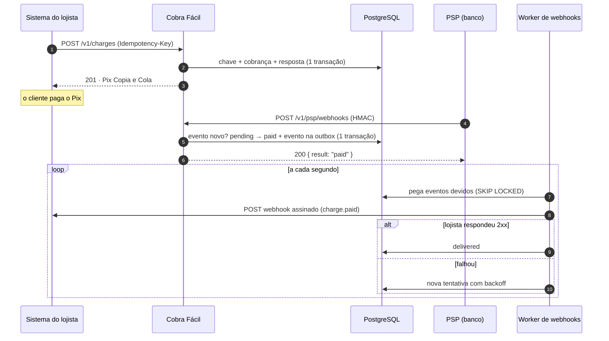

# Cobra Fácil

[](https://github.com/fesqueira/cobra-facil/actions/workflows/ci.yml)
[](https://github.com/fesqueira/cobra-facil/actions/workflows/codeql.yml)
[](https://fesqueira.github.io/cobra-facil/)
[](LICENSE)

API de **cobranças Pix** para pequenos negócios, em **Node.js + TypeScript**. O lojista cria
uma cobrança e recebe o Pix Copia e Cola. Quando o provedor de pagamento (PSP) confirma o
Pix, a API marca a cobrança como paga e avisa o sistema do lojista por um **webhook
assinado**, tentando de novo até ele responder.

**📖 Documentação interativa da API: [fesqueira.github.io/cobra-facil](https://fesqueira.github.io/cobra-facil/)**

Fastify 5 · TypeScript (strict) · Zod 4 · PostgreSQL 17 · Vitest + Testcontainers · Docker · GitHub Actions

## O que este projeto resolve

Criar uma cobrança é fácil. O difícil num sistema de pagamento é o que acontece quando as
coisas dão errado. Cada problema abaixo tem uma solução no código e um teste que a prova:

| Problema real | Como a API resolve | Onde |
| --- | --- | --- |
| A rede cai e o sistema do lojista reenvia o pedido: duas cobranças? | `Idempotency-Key`: chave, cobrança e resposta são gravadas **na mesma transação**. O reenvio devolve a mesma cobrança; a mesma chave com outro corpo dá 422 | [service.ts](src/modules/charges/service.ts) |
| Oito requisições iguais chegam **ao mesmo tempo** | A segunda espera o lock da linha da primeira e devolve a resposta dela. O teste dispara 8 em paralelo e confere que existe 1 cobrança | [charges.test.ts](test/integration/charges.test.ts) |
| O PSP manda a mesma confirmação duas vezes | Deduplicação por `eventId` na tabela `psp_events`, dentro da transação do pagamento | [payments/service.ts](src/modules/payments/service.ts) |
| Pagamento e expiração (ou cancelamento) ao mesmo tempo | `SELECT … FOR UPDATE` e update condicional `WHERE status = 'pending'`: só um vence | [expire-charges.ts](src/jobs/expire-charges.ts) |
| O servidor cai depois de marcar como paga e antes de avisar o lojista | **Transactional outbox**: o evento é gravado na mesma transação da mudança de status e entregue depois por um worker | [outbox.ts](src/modules/webhooks/outbox.ts) |
| Duas instâncias da API mandam o mesmo webhook | `FOR UPDATE SKIP LOCKED` + lease: cada evento é pego por um worker só, e volta para a fila se o worker morrer | [dispatcher.ts](src/modules/webhooks/dispatcher.ts) |
| O site do lojista está fora do ar | Novas tentativas com espera exponencial e jitter (10 s, 20 s, 40 s … até 1 h), 8 tentativas no máximo | [dispatcher.ts](src/modules/webhooks/dispatcher.ts) |
| Alguém forja uma confirmação de pagamento | HMAC-SHA256 sobre o **corpo bruto**, comparado em tempo constante | [payments/routes.ts](src/modules/payments/routes.ts) |
| Alguém reenvia um webhook antigo para o lojista | Assinatura `t=<timestamp>,v1=<hmac>` com janela de 5 minutos (mesmo esquema da Stripe) | [crypto.ts](src/lib/crypto.ts) |
| R$ 0,1 + R$ 0,2 ≠ R$ 0,3 | Dinheiro em **centavos inteiros**, do banco ao BR Code, sem ponto flutuante | [brcode.ts](src/lib/pix/brcode.ts) |
| Vazamento do banco expõe as chaves de API | Só o hash SHA-256 da chave é guardado; ela é mostrada uma única vez | [merchants/routes.ts](src/modules/merchants/routes.ts) |

## Como funciona



O PSP é simulado: o endpoint `/v1/psp/webhooks` recebe a notificação no formato que um banco
mandaria. Trocar por um PSP real (Efí, Sicredi, Inter…) é implementar só esse adaptador.

## Rodando em 1 minuto

Precisa de Docker e Node.js 22 ou mais novo.

```bash
git clone https://github.com/fesqueira/cobra-facil.git && cd cobra-facil
docker compose up -d --build --wait     # API em localhost:3000 + PostgreSQL
npm ci && npm run demo                  # roda o fluxo completo contra a API
```

A demonstração cria um lojista, sobe um receptor de webhooks local, cria uma cobrança,
repete a requisição, simula o PSP confirmando o Pix e espera o webhook assinado:

```
3. Lojista cria uma cobrança de R$ 25,90
   status: pending
   Pix Copia e Cola: 00020126560014br.gov.bcb.pix0119padaria@exemplo.com0211Pedido 1234…6304926F

4. A mesma requisição de novo (queda de rede, retry): nada é duplicado
   mesma cobrança: true
   Idempotent-Replayed: true

5. O PSP avisa que o Pix foi pago (corpo assinado com HMAC)
   resposta: {"result":"paid"}
   mesmo evento de novo: {"result":"duplicate"}

6. O sistema do lojista recebe o webhook assinado
   evento: charge.paid
   status da cobrança: paid
```

Com a API rodando, a documentação interativa fica em <http://localhost:3000/docs>.
Se a porta 5432 já estiver em uso, rode `DB_PORT=5433 docker compose up -d --build --wait`.

### Desenvolvimento sem Docker para a API

```bash
cp .env.example .env
docker compose up -d db                 # ou um PostgreSQL seu, ajustando DATABASE_URL
npm run migrate
npm run dev                             # recarrega a cada alteração, logs legíveis
WEBHOOK_HOST=localhost npm run demo
```

## Endpoints

| Método | Rota | Autenticação | O que faz |
| --- | --- | --- | --- |
| `POST` | `/v1/merchants` | `x-admin-token` | Cria um lojista; devolve `apiKey` e `webhookSecret` uma vez |
| `GET` | `/v1/merchants/me` | Bearer | Dados do lojista |
| `PATCH` | `/v1/merchants/me` | Bearer | Altera a URL de webhook |
| `POST` | `/v1/charges` | Bearer + `Idempotency-Key` | Cria uma cobrança Pix |
| `GET` | `/v1/charges?status=&limit=&cursor=` | Bearer | Lista, com paginação por cursor |
| `GET` | `/v1/charges/:id` | Bearer | Consulta uma cobrança |
| `POST` | `/v1/charges/:id/cancel` | Bearer | Cancela uma cobrança pendente |
| `POST` | `/v1/psp/webhooks` | `x-psp-signature` | Confirmação de pagamento vinda do PSP |
| `GET` | `/health` | — | Saúde da API e do banco |
| `GET` | `/docs`, `/openapi.json` | — | Documentação (OpenAPI 3 gerado dos schemas Zod) |

Erros seguem sempre o mesmo formato, com um código estável para o cliente tratar:

```json
{ "error": { "code": "IDEMPOTENCY_KEY_REUSED", "message": "Esta Idempotency-Key já foi usada com outro corpo de requisição." } }
```

## Na mão, com curl

```bash
API=http://localhost:3000

# 1. Lojista (guarde a apiKey: ela não aparece de novo)
curl -s -X POST $API/v1/merchants -H 'x-admin-token: troque-este-token-admin' \
  -H 'content-type: application/json' \
  -d '{"name":"Padaria Pão Quente","city":"Marília","pixKeyType":"email","pixKey":"padaria@exemplo.com"}'
KEY=cf_live_...

# 2. Cobrança de R$ 25,90 (rode duas vezes: a resposta é a mesma)
curl -si -X POST $API/v1/charges -H "authorization: Bearer $KEY" -H 'idempotency-key: pedido-1234' \
  -H 'content-type: application/json' -d '{"amountCents":2590,"description":"Pedido 1234"}'
TXID=...

# 3. O PSP confirma o pagamento: o corpo é assinado com HMAC-SHA256
BODY='{"eventId":"evt-1","type":"pix.received","txid":"'$TXID'","amountCents":2590,"paidAt":"2026-11-12T12:00:00Z"}'
SIG=$(printf '%s' "$BODY" | openssl dgst -sha256 -hmac 'troque-este-segredo-do-psp' | cut -d' ' -f2)
curl -s -X POST $API/v1/psp/webhooks -H "x-psp-signature: sha256=$SIG" \
  -H 'content-type: application/json' -d "$BODY"
```

## Verificando o webhook no sistema do lojista

Cada webhook leva `cobra-signature: t=<unix>,v1=<hex>`, onde `v1` é o HMAC-SHA256 de
`"<t>.<corpo>"` com o `webhookSecret` do lojista. Para conferir (Node.js):

```ts
import { verifyWebhook } from "./src/lib/crypto.js";

// rawBody: o corpo exatamente como chegou, antes de qualquer JSON.parse
if (!verifyWebhook(process.env.COBRA_WEBHOOK_SECRET!, req.headers["cobra-signature"], rawBody)) {
  return res.status(400).end(); // assinatura inválida ou mais velha que 5 minutos
}
```

Eventos: `charge.paid`, `charge.expired`, `charge.canceled`. O corpo é
`{ id, type, createdAt, data: { charge } }`; use o `id` para ignorar entregas repetidas.

## Testes

```bash
npm test                    # tudo (sobe um PostgreSQL real com Testcontainers)
npm run test:unit           # só os unitários, sem Docker
npm run coverage
```

53 testes, ~95% de cobertura. Os de integração rodam contra um **PostgreSQL 17 de verdade**,
não contra mocks, porque é no banco que moram as garantias (transações, locks, constraints).
Entre eles:

- 8 requisições simultâneas com a mesma `Idempotency-Key` criam uma única cobrança;
- 3 confirmações iguais do PSP em paralelo pagam uma vez só;
- 4 workers entregando webhooks ao mesmo tempo não repetem nenhum evento;
- falha do lojista → nova tentativa com espera → desistência depois de 8 tentativas;
- o BR Code gerado bate com o exemplo oficial do Banco Central (CRC16 `1D3D`).

O CI roda lint, tipos, testes, build, sobe o `docker compose` e executa a demonstração
ponta a ponta. Na `main`, publica a imagem em `ghcr.io/fesqueira/cobra-facil`.

> No Fedora (SELinux), o container Ryuk do Testcontainers pode ser bloqueado. Nesse caso:
> `TESTCONTAINERS_RYUK_DISABLED=true npm test`.

## Estrutura

```
src/
  app.ts                 montagem do Fastify: segurança, rate limit, OpenAPI, erros
  server.ts              processo: configuração, workers e desligamento gracioso
  config.ts              variáveis de ambiente validadas com Zod (não sobe se faltar algo)
  db/                    conexão, migrações SQL versionadas
  lib/pix/               BR Code: TLV, CRC16, chaves Pix (CPF, CNPJ, celular, e-mail, aleatória)
  lib/crypto.ts          hash, HMAC, assinatura e verificação de webhooks
  modules/merchants/     lojistas e chaves de API
  modules/charges/       cobranças, idempotência, paginação
  modules/payments/      confirmação do PSP
  modules/webhooks/      outbox e worker de entrega
  jobs/                  expiração de cobranças e agendador sem sobreposição
test/unit/               regras puras
test/integration/        API + PostgreSQL real
scripts/demo.ts          fluxo completo contra uma API rodando
```

## Decisões e próximos passos

- **Uma transação para a idempotência**, em vez de um estado "em andamento": não existe
  cobrança sem resposta guardada, nem chave sem cobrança. Se a criação falha, a chave fica
  livre para uma nova tentativa. As chaves valem por 24 horas.
- **Paginação por cursor** (`created_at, id`) em vez de `OFFSET`: páginas não repetem nem
  pulam itens quando entram cobranças novas, e o custo não cresce com a página.
- **Workers no mesmo processo** (`RUN_WORKERS=true`) para simplificar o deploy; como a fila
  usa `SKIP LOCKED`, dá para separá-los em outro processo ou escalar horizontalmente sem
  mudar o código.
- Para produção, faltaria: Pix dinâmico com a API de um PSP real, bloqueio de IPs internos
  na URL de webhook (SSRF), rotação de chaves e segredos, métricas (OpenTelemetry) e uma
  rotina de limpeza dos eventos entregues.

## Autor

Feito por **Felipe Siqueira**, desenvolvedor e fundador da Simplifica Tech.
[LinkedIn](https://www.linkedin.com/in/felipe-rodrigues-siqueira-00694a369/) · [GitHub](https://github.com/fesqueira) ·
Veja também o [Pix Fácil](https://github.com/fesqueira/pix-facil), o gerador de QR Code Pix
de onde veio o código do BR Code.

Licença [MIT](LICENSE).
